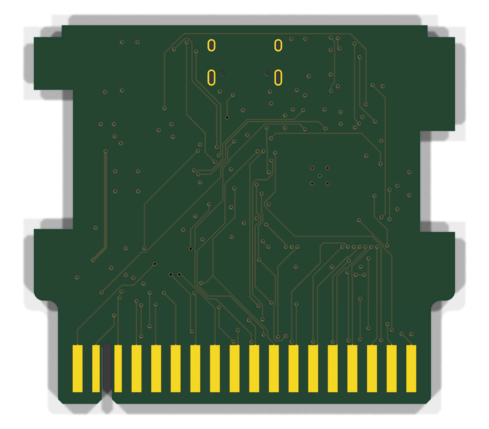

# 2068 PicoCart

A dock cartridge for the Timex Sinclair 2068, built around a Raspberry Pi RP2354B (RP2350 with 2 MB of flash in the package). It emulates the cartridge ROM and RAM in the dock bank. To load a cart, plug the cart into your computer with USB-C and copy a `.dck` or `.bin` file onto it as if it were a thumb drive.

| Top | Bottom |
|:---:|:---:|
|  |  |

## Features

- **Thumb-drive loading.** Over USB the cart appears as a 1.4 MB drive called `PICOCART`. Copy a cart onto it, then switch the 2068 off and on. The cart serves the file you copied most recently and remembers it across power cycles.
- **AROS and LROS images.** Supports `.dck` files (the EightyOne/Warajevo dock format, including RAM chunks) and raw `.bin`/`.rom` images. A raw image loads at $8000 unless its name gives an address, for example `GAME@0000.BIN`.
- **Full-speed bus emulation.** One RP2350 core does nothing but serve the bus. It runs from SRAM with interrupts off and handles about 650,000 dock reads per second in the 2068.
- **On-screen cart menu.** Hold **MENU** while switching the 2068 on, and it shows a list of the carts on the drive. Pick one with the cursor keys (or Q/A) and ENTER, and the 2068 restarts into that cart, with no power cycle. Pressing MENU while the 2068 runs brings the menu up at the next power-up instead, even with no USB power in between. The first entry starts the 2068 in BASIC with the cart off the bus.
- **No USB needed in the 2068.** The cart runs on the 2068's own +5 V. USB is only for copying carts onto it, and the cart can be powered by USB alone for that.
- **Safe on the bus.** The 74LVC245 data buffer stays off until the cart sees the 2068's +5 V hold steady.
- **USB serial.** Status and debug output come over the same USB-C cable. `picotool load -f` can reflash the cart without pressing BOOTSEL.

## Hardware

- 4-layer board: signal, GND, +3V3, signal. KiCad 10 project in [`hardware/`](hardware).
- RP2354B, 74LVC245 buffer on the data bus, a 74LVC1G332 for buffer enable, a 3.3 V LDO, USB-C, and two buttons: MENU and BOOTSEL.
- Red LED = cart on the bus. White LED = dock activity. R15, the white LED's resistor, is 3.3 kΩ; rev 0.1 boards have 100 Ω.
- The board and the routing are generated by scripts in [`hardware/scripts`](hardware/scripts). The pinout and BOM are in [SCHEMATIC.md](SCHEMATIC.md); the design notes are in [PLAN.md](PLAN.md).
- JLCPCB Gerbers, BOM and placement file are in [`hardware/fab/jlcpcb`](hardware/fab/jlcpcb). Read [hardware/fab/NOTES.md](hardware/fab/NOTES.md) before ordering. It covers the finger bevel, the parts that aren't assembled, and the L1 orientation.

### GPIO map

| GPIO | Signal |
|---|---|
| 0–15 | A0–A15 |
| 16–23 | MD0–MD7 (MCU side of the 74LVC245) |
| 24–31 | ROSCS, MREQ, RD, WR, IORQ, M1, RFSH, EXROM |
| 32 | BUS_OFF (high = buffer off) |
| 33 | BE (via the R10 link, not fitted) |
| 37 | A7R |
| 40 / 41 | DOCK +5 V and VBUS sense (ADC, 10k/15k dividers) |
| 43 / 44 | White / red LED |
| 45 | MENU button |
| 46 / 47 | UART TX / RX (test pads) |

## Firmware

Two programs are in [`firmware/`](firmware). Both use the board header in [`firmware/boards`](firmware/boards):

- [`bringup`](firmware/bringup) checks a new board. It holds the bus buffer off, then reports the +5 V rails, activity on the bus lines, and the MD float test over USB serial.
- [`romemu`](firmware/romemu) is the cartridge firmware. The cart menu is Z80 code in [`romemu/menu`](firmware/romemu/menu). The build reassembles it with [sjasmplus](https://github.com/z00m128/sjasmplus) when that's installed, and otherwise uses the committed `menu.bin`.

### How the menu works

The menu is a machine-code AROS cart that the firmware serves at $8000, with a directory table at $9000 that lists the carts on the drive. When you choose one, the menu copies a short routine into HOME RAM and runs it from there. The routine writes the entry number to $BFFF in the dock, the cart's mailbox. It then waits about a second while the firmware swaps in the chosen cart, pages HOME back in and jumps to $0000. The 2068 starts up again and reads the new cart's header. [`firmware/tests/menu_dck.py`](firmware/tests/menu_dck.py) builds the menu with a test directory as a `.dck`, for trying it in an emulator such as ZEsarUX.

### Build

You need the Pico SDK 2.2.0 or later, the Arm GNU toolchain, CMake, Ninja and picotool.

```bash
export PICO_SDK_PATH=~/pico-sdk PICO_TOOLCHAIN_PATH=~/arm-gnu-toolchain
cmake -S firmware/romemu -B firmware/romemu/build -G Ninja
ninja -C firmware/romemu/build
picotool load -f -x firmware/romemu/build/romemu.uf2
```

The first time, hold BOOTSEL while plugging in USB; after that, `picotool load -f` reboots the cart itself.

The white LED (D4) runs at 3% brightness by default, to suit rev 0.1 boards, where R15 is 100 Ω. On boards built from the current design (R15 = 3.3 kΩ), build with `-DLED2_PERCENT=100`:

```bash
cmake -S firmware/romemu -B firmware/romemu/build -DLED2_PERCENT=100
```

Optionally, you can compile a fallback image into the firmware. The cart serves it when the drive has no cart on it:

```bash
cmake -S firmware/romemu -B firmware/romemu/build -DROM_IMAGE="path/to/cart.dck"
```

### Flash layout

| Offset | Use |
|---|---|
| 0x000000 | Firmware (up to 512 KB) |
| 0x080000 | `PICOCART` drive: FAT12, 1.4 MB |
| 0x1FE000 | Settings log, two 4 KB sectors: the current cart, and whether the menu comes up at the next power-up |

On first boot the firmware formats the drive and puts a `README.TXT` on it. If the drive gets corrupted, reformat it from your computer as FAT.

## Using it

1. Plug the cart into your computer. The `PICOCART` drive appears.
2. Copy a `.dck`, `.bin` or `.rom` file onto it, then eject the drive.
3. Switch the 2068 off and on. The 2068 reads the dock only at power-up.

If the 2068 is running when you copy, the cart keeps serving the old cart until the 2068 is switched off. Both LEDs blink together while a new cart is waiting.

To switch between carts already on the drive, hold MENU while switching the 2068 on and pick one from the list. The cart you pick stays the current cart until you pick or copy another.

### Without USB

The cart doesn't need USB in the 2068. It runs on the 2068's +5 V and remembers everything in flash: the carts on the drive, the current cart, and a MENU press made while the 2068 was on. So you can fill the drive once and leave the cable at your computer:

1. Plug the cart into your computer on its own, with no 2068. USB powers it, and the `PICOCART` drive appears.
2. Copy carts onto it, eject the drive and unplug the cable.
3. Put the cart in the 2068 and switch it on. Choose carts with the menu.

From the 2068's power alone, the cart's firmware is running 0.1 ms after power reaches it, and the cart serves the bus about 1.8 s before the 2068 first reads the dock. You can plug USB in while the 2068 is on, for example to watch the serial status; the cart keeps running.

## Status

Rev 0.1 boards have been built and brought up. These carts run from the cart's ROM: AROS BASIC carts (Hello world, and Profile 2068's 16K at $8000–$BFFF), 32K machine-code carts (73000 Flight Simulator), and LROS carts that replace the HOME ROM (Space Raiders, 16K at $0000–$3FFF). RAM in the dock bank works: [`firmware/tests/ramtest.py`](firmware/tests/ramtest.py) builds a test cart that writes and checks two patterns across 8 KB of cart RAM at $C000. It passes, and the cart counted exactly 16,384 dock writes. Loading from the USB drive works. The cart runs on the 2068's power alone, with no USB. The on-screen cart menu works on the 2068: choosing a cart restarts the 2068 into it, and the "no cartridge" entry starts BASIC with the cart off the bus. Pressing MENU while a cart runs brings up the menu at the next power-up, with or without USB power in between, and a second press cancels it. Every feature has now been tested on hardware.

## License

The hardware is licensed under [CERN-OHL-P-2.0](hardware/LICENSE) and the firmware under [MIT](firmware/LICENSE). See [LICENSE.md](LICENSE.md) for details.
