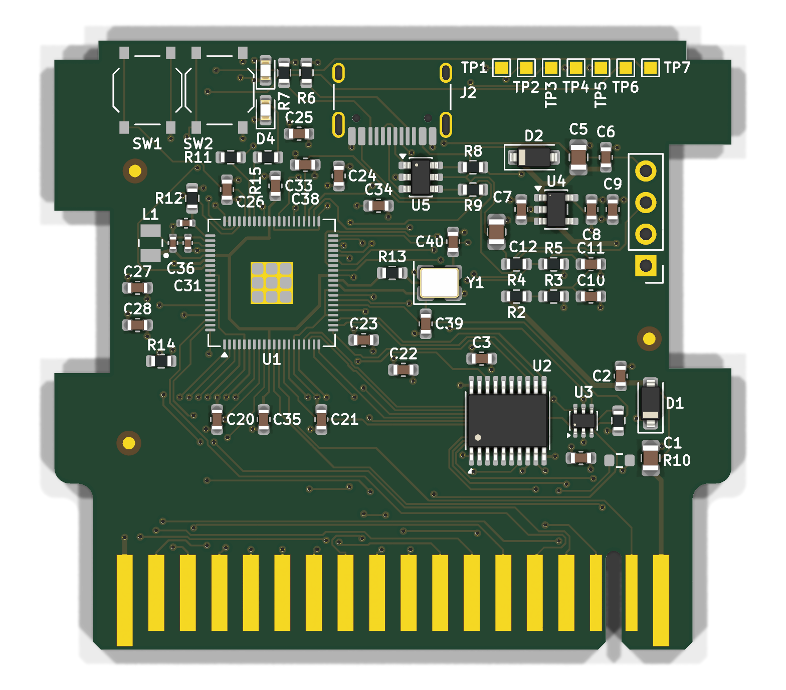

# 2068 PicoCart

A dock cartridge for the Timex Sinclair 2068, built around a Raspberry Pi RP2354B (RP2350 with 2 MB of flash in the package). It emulates the cartridge ROM and RAM in the dock bank. To load a cart, plug the cart into your computer with USB-C and copy a `.dck` or `.bin` file onto it as if it were a thumb drive.

| Top | Bottom |
|:---:|:---:|
|  |  |

## Features

- **Thumb-drive loading.** Over USB the cart appears as a 1.4 MB drive called `PICOCART`. Copy a cart onto it, then switch the 2068 off and on. The cart serves the file you copied most recently and remembers it across power cycles.
- **AROS and LROS images.** Supports `.dck` files (the EightyOne/Warajevo dock format, including RAM chunks) and raw `.bin`/`.rom` images. A raw image loads at $8000 unless its name gives an address, for example `GAME@0000.BIN`.
- **Full-speed bus emulation.** One RP2350 core does nothing but serve the bus. It runs from SRAM with interrupts off and handles about 650,000 dock reads per second in the 2068.
- **Safe on the bus.** The 74LVC245 data buffer stays off until the cart sees the 2068's +5 V hold steady. Hold **MENU** at power-up to start the 2068 without the cart.
- **USB serial.** Status and debug output come over the same USB-C cable. `picotool load -f` can reflash the cart without pressing BOOTSEL.
- **Optional display.** There are holes for a 0.91 in 128×32 SSD1306 I2C OLED (J3, not fitted at the factory).

## Hardware

- 4-layer board: signal, GND, +3V3, signal. KiCad 10 project in [`hardware/`](hardware).
- RP2354B, 74LVC245 buffer on the data bus, a 74LVC1G332 for buffer enable, a 3.3 V LDO, USB-C, and two buttons: MENU and BOOTSEL.
- Red LED = cart on the bus. White LED = dock activity.
- The board and the routing are generated by scripts in [`hardware/scripts`](hardware/scripts). The pinout and BOM are in [SCHEMATIC.md](SCHEMATIC.md); the design notes are in [PLAN.md](PLAN.md).
- JLCPCB Gerbers, BOM and placement file are in [`hardware/fab/jlcpcb`](hardware/fab/jlcpcb). Read [hardware/fab/NOTES.md](hardware/fab/NOTES.md) before ordering. It covers the finger bevel, the parts that aren't assembled, and the L1 orientation.

### GPIO map

| GPIO | Signal |
|---|---|
| 0–15 | A0–A15 |
| 16–23 | MD0–MD7 (MCU side of the 74LVC245) |
| 24–31 | ROSCS, MREQ, RD, WR, IORQ, M1, RFSH, EXROM |
| 32 | BUS_OFF (high = buffer off) |
| 33 | BE (via the R10 link, not fitted) |
| 34 / 35 | I2C1 SDA / SCL (OLED) |
| 37 | A7R |
| 40 / 41 | DOCK +5 V and VBUS sense (ADC, 10k/15k dividers) |
| 43 / 44 | White / red LED |
| 45 | MENU button |
| 46 / 47 | UART TX / RX (test pads) |

## Firmware

Two programs are in [`firmware/`](firmware). Both use the board header in [`firmware/boards`](firmware/boards):

- [`bringup`](firmware/bringup) checks a new board. It holds the bus buffer off, then reports the +5 V rails, activity on the bus lines, the MD float test and an I2C scan over USB serial.
- [`romemu`](firmware/romemu) is the cartridge firmware.

### Build

You need the Pico SDK 2.2.0 or later, the Arm GNU toolchain, CMake, Ninja and picotool.

```bash
export PICO_SDK_PATH=~/pico-sdk PICO_TOOLCHAIN_PATH=~/arm-gnu-toolchain
cmake -S firmware/romemu -B firmware/romemu/build -G Ninja
ninja -C firmware/romemu/build
picotool load -f -x firmware/romemu/build/romemu.uf2
```

The first time, hold BOOTSEL while plugging in USB; after that, `picotool load -f` reboots the cart itself.

Optionally, you can compile a fallback image into the firmware. The cart serves it when the drive has no cart on it:

```bash
cmake -S firmware/romemu -B firmware/romemu/build -DROM_IMAGE="path/to/cart.dck"
```

### Flash layout

| Offset | Use |
|---|---|
| 0x000000 | Firmware (up to 512 KB) |
| 0x080000 | `PICOCART` drive: FAT12, 1.4 MB |
| 0x1FF000 | Name of the remembered cart |

On first boot the firmware formats the drive and puts a `README.TXT` on it. If the drive gets corrupted, reformat it from your computer as FAT.

## Using it

1. Plug the cart into your computer. The `PICOCART` drive appears.
2. Copy a `.dck`, `.bin` or `.rom` file onto it, then eject the drive.
3. Switch the 2068 off and on. The 2068 reads the dock only at power-up.

If the 2068 is running when you copy, the cart keeps serving the old cart until the 2068 is switched off. Both LEDs blink together while a new cart is waiting. The cart can be powered by the 2068, by USB, or by both at once.

## Status

Rev 0.1 boards have been built and brought up. Both AROS BASIC carts and 32K machine-code carts (73000 Flight Simulator) run, and loading from the USB drive works.

Not tested yet:
- carts with RAM chunks
- LROS images
- the OLED
- switching between carts with MENU
